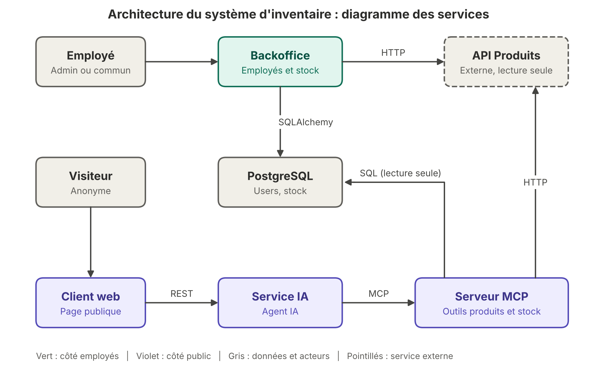

# HBntory

## Project overview

HBntory est un système de gestion de stock pour une entreprise qui possède plusieurs magasins (succursales).
Les employés gèrent le stock de leur magasin depuis un espace interne, et les clients peuvent interroger une IA pour savoir dans quelle succursale un produit est disponible.

L'objectif : centraliser les stocks de tous les magasins, pour savoir à tout moment où un produit est disponible.

### Backoffice (employés et admin)

Un site interne, accessible uniquement après connexion.

- **Employé** : rattaché à un seul magasin, il peut ajouter, retirer et consulter le stock de ce magasin, et lister les produits disponibles. Il ne peut ni gérer les utilisateurs, ni agir sur le stock d'un autre magasin.
- **Admin** (un seul compte) : il gère les employés de tous les magasins (création, modification, désactivation, changement de mot de passe et de magasin). Il ne gère jamais le stock.

### Client Web (clients)

Un site public, sans connexion : les clients restent anonymes.
Ils posent leurs questions en langage naturel à une IA, qui répond à partir des données produits et des stocks disponibles.
Si l'information n'est pas disponible, l'IA doit le signaler au lieu de l'inventer.

## Team members

| Membre | Partie |
|---|---|
| Mathieu Bailliez | Backoffice, base de données |
| Driss Chaneac | Service IA, serveur MCP, Client Web |

## Architecture summary

Les données viennent de deux sources :

- **La Product API** (fournie, en lecture seule) : le catalogue des produits (nom, description, prix).
- **Notre base de données** : une seule base centrale, partagée par tous les magasins. Elle contient les employés, les magasins et les quantités en stock.

Ce qui relie les deux, c'est **l'identifiant du produit** : la base sait combien il y a du produit n° 42 dans chaque magasin, mais seule la Product API sait ce qu'est le produit n° 42.

L'IA n'accède jamais directement à ces données : elle passe par un serveur MCP, qui lui donne un accès contrôlé à travers un nombre limité d'outils en lecture seule.



### Services

| Service | Rôle |
|---|---|
| `bdd` | Base PostgreSQL centrale (employés, agences, stock) |
| `external-products-api` | Product API fournie : catalogue des produits |
| `backoffice` | Backoffice Flask (employés et admin) |
| `product-mcp-server` | Serveur MCP : accès contrôlé de l'IA aux produits et au stock |
| `ai_service` | API REST qui orchestre le modèle IA et les outils MCP |
| `client_web` | Interface web publique pour poser des questions |

### Technologies

| Technologie | Rôle dans le projet |
|---|---|
| Python | Backoffice et serveur HTTP de développement du Client Web |
| TypeScript (Node.js) | Serveur MCP et Service IA |
| Flask + Jinja2 | Backoffice : le serveur fabrique les pages HTML (SSR) |
| PostgreSQL | Base de données centrale : employés, magasins, stocks |
| SQLAlchemy | Accès à la base de données depuis le Backoffice |
| Docker + Docker Compose | Lancement de la base, de l'API produits, du Backoffice et du MCP |
| MCP (SDK TypeScript) | Accès contrôlé de l'IA aux produits et au stock (transport stdio) |
| Ollama | Exécution locale du modèle de langage |
| HTML, CSS et JavaScript | Interface publique Client Web |

Justification des choix : voir [docs/decisions.md](docs/decisions.md)

Détails : voir [docs/architecture.md](docs/architecture.md)

## Setup instructions

### Prérequis

- Git
- Docker et Docker Compose
- Node.js et npm
- Python 3
- [Ollama](https://ollama.com/) avec le modèle configuré dans le Service IA

### Récupérer le projet

```bash
git clone https://github.com/Mathieu-Bailliez/hbntory.git
cd hbntory
```

### Configurer les variables d'environnement

```bash
cp .env.example .env
```

Remplir les valeurs vides du `.env` (chaque variable est expliquée dans le fichier) :

| Variable | Rôle |
|---|---|
| `POSTGRES_PASSWORD` | Mot de passe de la base (lettres et chiffres) |
| `ADMIN_PASSWORD` | Mot de passe du compte admin créé par le seed |
| `DEMO_USER_PASSWORD` | Mot de passe des employés de démonstration |
| `SECRET_KEY` | Clé de signature des cookies : `python3 -c "import secrets; print(secrets.token_hex(32))"` |
| `MCP_DB_PASSWORD` | Mot de passe du compte PostgreSQL en lecture seule du serveur MCP |

Le fichier `.env` ne doit jamais être commité.

## How to run each service

Les commandes suivantes correspondent à un lancement local de développement. Ouvrir trois terminaux depuis la racine du dépôt.

### 1. Démarrer les services Docker

```bash
docker compose up -d --build
```

Cette commande démarre notamment PostgreSQL, la Product API et le Backoffice. Le serveur MCP est ensuite lancé automatiquement par le Service IA via Docker Compose lorsqu'une question nécessite son utilisation.

| Service | Rôle | Accès |
|---|---|---|
| `bdd` | Base PostgreSQL | `localhost:5432` |
| `external-products-api` | Product API fournie (catalogue) | Interne uniquement : `http://external-products-api:5000` depuis les autres conteneurs |
| `backoffice` | Backoffice Flask | http://localhost:5000 |
| `product-mcp-server` | Serveur MCP (stdio) | Lancé par le Service IA |

### 2. Démarrer le Service IA

Dans un deuxième terminal :

```bash
cd ai_service
npm install
npm run dev
```

Le Service IA écoute par défaut sur le port `3001`.

Vérifier son état en ouvrant http://localhost:3001/health. Une réponse JSON avec `"status":"ok"` indique que le serveur répond.

### 3. Démarrer le Client Web

Dans un troisième terminal, depuis la racine du dépôt :

```bash
cd client_web
python3 -m http.server 5500
```

Ouvrir ensuite http://localhost:5500 dans le navigateur.

Le Client Web envoie les questions au point d'entrée REST `http://localhost:3001/api/query`. Le navigateur, le Service IA, Ollama et les services Docker doivent être démarrés pour que les questions puissent être traitées.

### Commandes utiles

```bash
docker compose ps                      # état des conteneurs
docker compose logs -f backoffice      # journaux du Backoffice
docker compose down                    # tout arrêter (les données sont gardées)
docker compose down -v                 # tout arrêter ET effacer la base
```

## How to initialize the database

Au premier lancement, PostgreSQL crée automatiquement les tables et le compte en lecture seule du serveur MCP à partir des scripts de `db/init/`. Ces scripts ne sont exécutés que si la base est vide (premier lancement ou après `down -v`).

Il faut ensuite insérer les données de départ (agences, compte admin, employés de démonstration, stock) :

```bash
docker compose exec backoffice python seed.py
```

Le seed peut être relancé sans risque : il ne crée que ce qui n'existe pas encore.

## How to access the Backoffice

Ouvrir http://localhost:5000 :

| Compte | Identifiant | Mot de passe | Arrive sur |
|---|---|---|---|
| Admin | `admin` | valeur de `ADMIN_PASSWORD` | `/admin/users` (gestion des employés) |
| Employé (agence Paris) | `alice` | valeur de `DEMO_USER_PASSWORD` | `/stock` (stock de son agence) |
| Employé (agence Lyon) | `bruno` | valeur de `DEMO_USER_PASSWORD` | `/stock` (stock de son agence) |

## How to use the Client Web Interface

Le Client Web est une interface publique et anonyme. Aucune connexion n'est nécessaire.

1. Démarrer les services Docker, le Service IA et le Client Web (voir « How to run each service »).
2. Ouvrir http://localhost:5500.
3. Saisir une question sur un produit ou le stock d'une agence, puis cliquer sur **Envoyer ma question**.
4. Attendre la réponse. Un indicateur de chargement est affiché pendant le traitement et un message d'erreur apparaît si la requête échoue.

Exemples de questions :

- « Donne-moi les détails du produit 15. »
- « Quels produits sont disponibles à Paris ? »
- « Donne-moi le stock du produit 15 dans toutes les agences. »
- « Je souhaite acheter les produits 1 et 15. Dans quelle agence puis-je les trouver ? »

## Main technical decisions

- **Pages fabriquées par le serveur (Flask + Jinja2)**, sans JavaScript côté navigateur dans le Backoffice : plus simple à sécuriser et à tester.
- **Connexion par session** (cookie signé par `SECRET_KEY`) et **mots de passe hachés avec Argon2id** : jamais de mot de passe en clair, ni en base ni dans les journaux.
- **L'agence d'un employé vient toujours de son compte** (`g.user.branch_id`), jamais du formulaire : un employé ne peut pas agir sur une autre agence, même en modifiant la page.
- **Suppression douce (soft-delete)** : un employé supprimé est marqué `is_deleted` ; il ne peut plus se connecter, mais l'historique et le stock de son agence sont conservés.
- **Une seule base PostgreSQL centrale**, avec un compte en lecture seule pour le serveur MCP : l'IA ne peut rien modifier.
- **Tables créées par un script SQL, sans outil de migrations** : la structure de la base est simple et ne change pas, et les données sont fictives : il n'y a rien à conserver, la base peut être recréée à tout moment.
- **Client Web séparé du Backoffice** : l'interface publique communique avec le Service IA par HTTP REST.
- **Accès aux données par MCP** : le Service IA utilise des outils MCP prédéfinis ; l'IA n'exécute pas de SQL libre.

Détails et alternatives écartées : [docs/decisions.md](docs/decisions.md)

## Known limitations

- **Client Web sans authentification ni historique** : les questions sont indépendantes et aucune conversation n'est conservée.
- **Lancement local en mode développement** : le Client Web utilise le serveur statique de Python et le Service IA utilise `tsx watch`. Cette configuration est destinée au développement et à la démonstration, pas à une mise en production.
- **Pas de tests automatisés de bout en bout** : les scénarios fonctionnels du Client Web et du Service IA ont été vérifiés manuellement.
- **Pas de migrations** : modifier la structure de la base demande `docker compose down -v`, ce qui efface les données.
- **Serveur de développement Flask** : convient pour la démonstration, pas pour la production.
- **Produit saisi par son identifiant** : pas de liste déroulante des produits dans le Backoffice.
- **Agences créées par le seed** : il n'y a pas d'écran pour ajouter une agence.
- **Si la Product API est en panne**, les noms des produits ne s'affichent pas et les ajouts sont refusés (le stock reste consultable).

### Améliorations prévues

Tests automatisés avec `pytest` sur le stock, migrations avec Flask-Migrate, serveur Gunicorn, liste déroulante des produits et tests automatisés de bout en bout.

## Optional features implemented

Aucune pour le moment.

## Documentation

- [Architecture](docs/architecture.md) : les services et leurs échanges
- [MVP](docs/mvp.md) : le périmètre minimum du projet
- [Décisions techniques](docs/decisions.md) : nos choix et leurs justifications
- [Base de données](docs/database.md) : tables, contraintes, initialisation
- [Authentification](docs/auth.md) : session, mots de passe, rôles
- [Backoffice](docs/backoffice.md) : fonctionnalités employé et admin
- [Tests du Backoffice](docs/test.md) : script de test manuel et résultats
- [Tests du serveur MCP](docs/product-mcp-tests.md) : tests des outils MCP produits
- [Contribuer](docs/CONTRIBUTING.md) : notre façon de travailler avec Git

## Installation

Pour installer et exécuter le projet, veuillez suivre le [Guide d'installation](docs/INSTALLATION.md).
