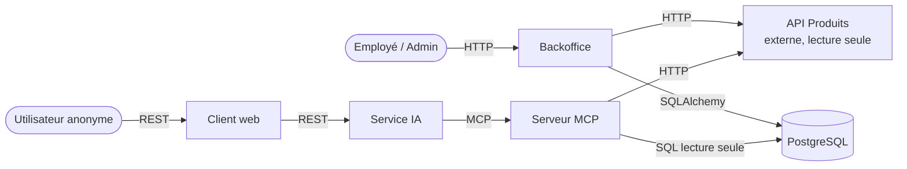

# Architecture du système d'inventaire

## 1. Vue d'ensemble

Le système permet à une entreprise de vente au détail de gérer le stock de ses
succursales et de répondre aux questions des clients en langage naturel.

Il se compose de deux parties indépendantes :
- Un **Backoffice** pour les employés (gestion des utilisateurs et du stock).
- Un **service de requêtes IA** pour le public (questions sur les produits et le stock).

Les données produits ne sont jamais copiées localement : elles viennent toujours
de l'API Produits externe.

## 2. Services

### 2.1 Backoffice
- **Rôle :** authentifier les utilisateurs, gérer les utilisateurs (admin) et le
  stock de leur succursale (utilisateurs communs).
- **Ne fait pas :** stocker des données produits, contenir de l'IA.
- **Communique avec :** la base de données (SQLAlchemy) et l'API Produits (HTTP,
  pour afficher les noms de produits).
- **Technologie :** FastAPI.

### 2.2 Base de données
- **Rôle :** stocker les données locales (voir section 4).
- **Technologie :** PostgreSQL, dans son propre conteneur.
- **Accès :** lecture/écriture pour le Backoffice, lecture seule pour le MCP.

### 2.3 API Produits (externe)
- **Rôle :** source unique et en lecture seule des données produits.
- **Fournie :** conteneur Docker, non modifiable par l'équipe.

### 2.4 Serveur MCP
- **Rôle :** exposer à l'agent IA des outils sécurisés.
- **Outils produits :** lister les produits, obtenir le détail d'un produit.
- **Outils stock :** requêtes prédéfinies en lecture seule (stock d'un produit par
  succursale, produits d'une succursale).
- **Ne fait pas :** exécuter du SQL libre, écrire dans la base.

### 2.5 Service IA
- **Rôle :** recevoir une question, laisser l'agent choisir les outils MCP à
  appeler, renvoyer une réponse.
- **Indépendant du Backoffice :** conteneur et code séparés.
- **Règle anti-hallucination :** si les outils ne fournissent pas l'information,
  l'agent doit répondre que l'information n'est pas disponible.

### 2.6 Client web
- **Rôle :** page simple où l'utilisateur anonyme saisit une question et lit la
  réponse.
- **Ne fait pas :** authentification, historique de conversation.

## 3. Communication entre services

| Source | Destination | Protocole | Raison |
|---|---|---|---|
| Navigateur | Backoffice | HTTP | Utilisation par les employés |
| Backoffice | Base de données | SQLAlchemy | Lecture/écriture des données locales |
| Backoffice | API Produits | HTTP | Récupérer les noms de produits |
| Client web | Service IA | REST | Questions indépendantes (voir decisions.md) |
| Service IA | Serveur MCP | MCP | Accès aux outils (voir decisions.md) |
| Serveur MCP | API Produits | HTTP | Récupérer les données produits |
| Serveur MCP | Base de données | SQL (lecture seule) | Consulter le stock |

## 4. Données

### 4.1 Stockées localement
- **Utilisateurs :** identifiant, mot de passe haché, rôle, succursale, indicateur
  de suppression logique.
- **Succursales :** identifiant, nom.
- **Stock :** succursale, identifiant du produit, quantité (jamais négative).

### 4.2 Provenant de l'API Produits
Nom, description, prix, images, métadonnées : tout ce qui décrit un produit.

> L'identifiant de produit dans la table de stock est une simple **référence**
> vers l'API externe, pas une clé étrangère vers une table locale.

## 5. Accès de l'agent IA aux informations

- **Produits :** via les outils du serveur MCP, qui appellent l'API Produits.
- **Stock :** via des outils du même serveur MCP (requêtes fixes en lecture seule).
- **Justification du choix :** un MCP étendu limite précisément ce que l'agent peut
  faire (pas de SQL libre, pas d'écriture), au prix d'un peu plus de code qu'un
  outil tiers.

## 6. Déploiement

Un conteneur par composant, orchestrés par `docker-compose.yml` :
backoffice, ai_service, product_mcp_server, client_web, postgres, product_api.
