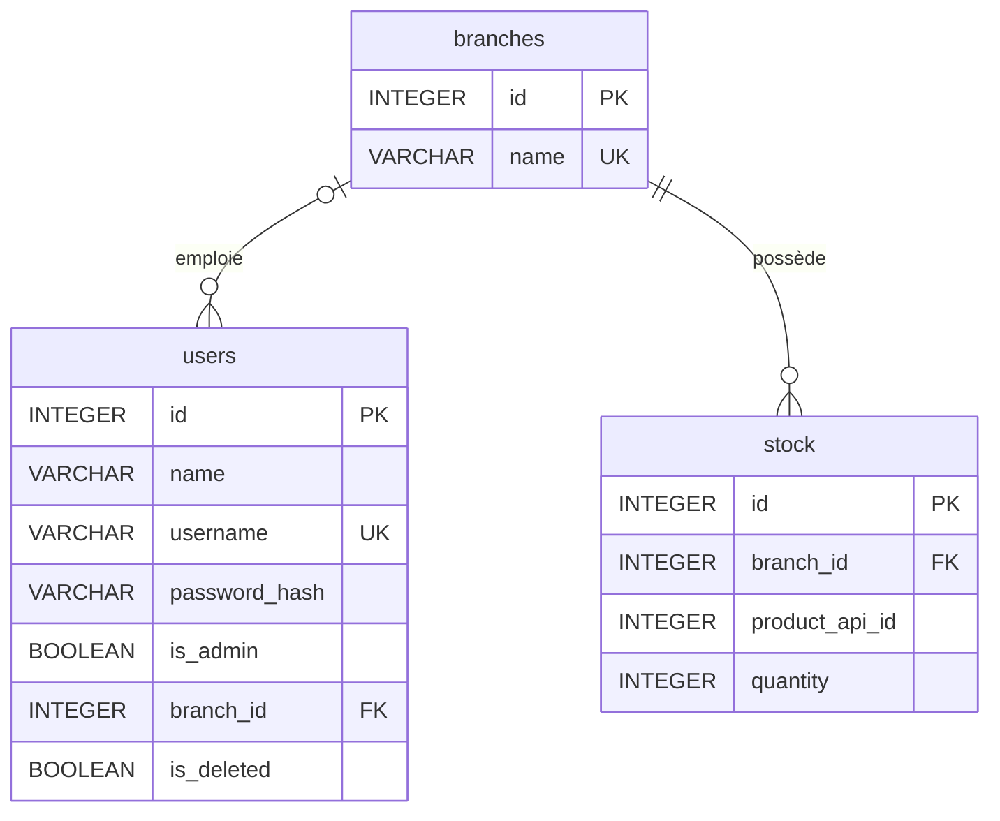

# Base de données HBntory

## 1. Rôle de la base

La base de données stocke les informations du Backoffice : les employés, les agences
et la quantité de chaque produit dans chaque agence. Elle est utilisée par deux chemins.

- **Chemin 1 : Backoffice (employés).** Les employés se connectent à un site web qui
  leur permet d'ajouter, de retirer, de consulter et de lister la quantité des produits
  de leur agence. L'admin y gère les employés. Le serveur de ce site web est connecté
  à la base de données.
- **Chemin 2 : Client web (clients anonymes).** Un client pose une question à l'IA.
  L'IA utilise des outils donnés par le serveur MCP. Ces outils récupèrent les
  informations dans la base de données (en lecture seule) et dans l'API Produits.
  L'IA combine ces vraies données pour donner une réponse formatée au client.

La base ne stocke ni le nom du produit, ni sa description, ni son prix : ces
informations sont déjà dans l'API Produits. Elle garde seulement l'identifiant du produit.

## 2. Lancer la base

### Prérequis
- Docker (version utilisée : 29.1.3)
- Docker Compose (version utilisée : 2.40.3)

Vérifier qu'ils sont installés :
```bash
docker --version
docker compose version
```

Sous Ubuntu, s'il en manque un :
```bash
sudo apt update
sudo apt install docker.io docker-compose-v2
```

### Configuration
Copier `.env.example` en `.env`, puis modifier les lignes avec nos choix personnels
(au minimum le mot de passe, qui est vide dans l'exemple) :
```bash
cp .env.example .env
```
Le fichier `.env` contient le mot de passe : il est ignoré par Git et ne doit jamais être poussé.

### Lancement
Démarrer uniquement le service `bdd`, en arrière-plan (`-d`) :
```bash
docker compose up -d bdd
```

### Vérification
1. La base est prête quand les journaux affichent `database system is ready to accept connections` :
```bash
docker compose logs bdd
```
2. Se connecter à la base avec `psql` (utilisateur `-U`, base `-d`), puis vérifier qui on est :
```bash
docker compose exec bdd psql -U hbntory -d hbntory_db
```
```sql
SELECT current_user, current_database();
```
Résultat attendu : `hbntory | hbntory_db`. Taper `\q` pour quitter.

## 3. Schéma



`product_api_id` désigne un produit de l'API Produits, qui n'est pas dans notre base.

## 4. Tables

### 4.1 branches
Une ligne = une agence.

| Colonne | Type | Contraintes | Description |
|---|---|---|---|
| `id` | `INTEGER` | Clé primaire, automatique | Identifiant unique de l'agence |
| `name` | `VARCHAR(100)` | `NOT NULL`, `UNIQUE` | Nom de l'agence |

### 4.2 users
Une ligne = un employé (utilisateur commun) ou l'admin.

| Colonne | Type | Contraintes | Description |
|---|---|---|---|
| `id` | `INTEGER` | Clé primaire, automatique | Identifiant unique de l'utilisateur |
| `name` | `VARCHAR(100)` | `NOT NULL` | Nom de l'employé |
| `username` | `VARCHAR(50)` | `NOT NULL`, `UNIQUE` | Identifiant de connexion, choisi par l'admin |
| `password_hash` | `VARCHAR(255)` | `NOT NULL` | Hash du mot de passe (jamais le mot de passe lui-même) |
| `is_admin` | `BOOLEAN` | `NOT NULL`, `DEFAULT false` | `true` pour l'admin, `false` pour un utilisateur commun |
| `branch_id` | `INTEGER` | Clé étrangère → `branches.id`, peut être `NULL` | Agence de l'utilisateur commun ; `NULL` pour l'admin |
| `is_deleted` | `BOOLEAN` | `NOT NULL`, `DEFAULT false` | `true` si l'utilisateur a été supprimé (suppression douce) |

### 4.3 stock
Une ligne = la quantité d'un produit précis dans une agence précise.

| Colonne | Type | Contraintes | Description |
|---|---|---|---|
| `id` | `INTEGER` | Clé primaire, automatique | Identifiant unique de la ligne |
| `branch_id` | `INTEGER` | `NOT NULL`, clé étrangère → `branches.id` | Agence qui possède ce stock |
| `product_api_id` | `INTEGER` | `NOT NULL` | Numéro du produit dans l'API Produits (pas une clé étrangère) |
| `quantity` | `INTEGER` | `NOT NULL`, `CHECK (quantity >= 0)` | Nombre d'exemplaires disponibles |

## 5. Relations
- `users.branch_id` → `branches.id` : un utilisateur commun appartient à une agence ;
  une agence peut avoir plusieurs employés. `NULL` pour l'admin.
- `stock.branch_id` → `branches.id` : une agence possède plusieurs lignes de stock.
- `stock.product_api_id` n'est **pas** une clé étrangère : les produits sont dans
  l'API Produits. Le lien est fait par le programme qui lit les deux
  (le code du Backoffice, ou l'IA via les outils MCP).

## 6. Règles et contraintes

| Règle de l'énoncé | Comment elle est garantie |
|---|---|
| Un utilisateur commun appartient à exactement une agence | `branch_id` ne contient qu'une valeur + `CHECK` : utilisateur commun ⇒ `branch_id` rempli |
| L'admin ne gère pas de stock | `CHECK` : admin ⇒ `branch_id` vide (`NULL`) + vérification dans le code (Tâche Auth) |
| Le stock est lié à une agence et à un identifiant produit externe | `branch_id` (clé étrangère) + `product_api_id` |
| Une seule ligne par agence et par produit | `UNIQUE (branch_id, product_api_id)` |
| Le stock ne devient jamais négatif | `CHECK (quantity >= 0)`. On accepte 0 pour représenter la rupture de stock. |
| Les détails des produits ne sont pas stockés | Seul `product_api_id` est gardé ; nom, prix, description restent dans l'API |
| Les utilisateurs supprimés ne sont pas effacés | `is_deleted = true` ; la ligne reste, la connexion est refusée |
| Quantité ajoutée ou retirée = entier positif ; produit existant dans l'API | Vérifié par le code Python avant d'écrire en base (détaillé avec la carte 4) |

## 7. Données initiales

À compléter avec le script d’initialisation (carte 3).

## 8. Choix de conception

- **Clé primaire `id` entière et automatique** : une donnée réelle (nom, prénom) peut
  se répéter ou changer ; un numéro attribué par la base est unique, jamais vide et stable.
- **Pas de table produits** : les produits sont dans l'API Produits. Les recopier créerait
  deux versions qui pourraient se contredire (par exemple un prix modifié dans l'API).
  On garde une seule source de vérité.
- **`product_api_id` (et non `product_id`)** : le mot `api` rappelle que ce numéro vient
  de l'API Produits, et donc que ce n'est pas une clé étrangère vers une table locale.
- **Connexion par `username` (et non par e-mail)** : le projet n'envoie aucun e-mail,
  donc un e-mail n'apporterait rien de plus qu'un username avec la contrainte `UNIQUE`.
  C'est l'admin qui crée les comptes : si un username est déjà pris, la base refuse.
- **Rôle représenté par `is_admin` (vrai / faux) plutôt qu'une colonne `role`** : le
  projet ne demande que deux rôles (admin et utilisateur commun), donc deux valeurs
  possibles suffisent. Un booléen évite aussi d'avoir à vérifier les caractères d'un
  texte comme `'admin'`.
- **Suppression douce avec `is_deleted` (vrai / faux)** : l'énoncé demande que les
  utilisateurs supprimés soient « soft-deleted ». On garde la ligne et on la marque ;
  un utilisateur avec `is_deleted = true` ne peut plus se connecter.
- **`quantity >= 0` (et non `> 0`)** : 0 représente la rupture de stock.
- **Pas de dates de création / modification** : recommandées par l'énoncé, mais aucune
  fonctionnalité du projet ne s'en sert ; l'énoncé demande de ne rien ajouter sans justification.

